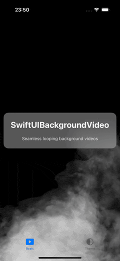
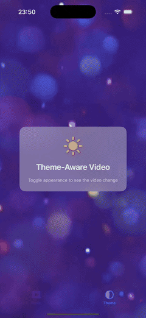

# SwiftUIBackgroundVideo

[](https://swiftpackageindex.com/ivan-magda/swiftui-background-video)
[](https://swiftpackageindex.com/ivan-magda/swiftui-background-video)
[](LICENSE)

Seamless looping background videos for SwiftUI, in one view. No configuration, no dependencies, iOS 13+.

<p align="leading">
  &nbsp;&nbsp;&nbsp;&nbsp;
</p>

## Table of Contents

- [Background](#background)
- [Features](#features)
- [Installation](#installation)
- [Usage](#usage)
- [Project Structure](#project-structure)
- [Contributing](#contributing)
- [License](#license)

## Background

SwiftUI's `VideoPlayer` targets interactive playback. It can't loop a clip or hide its controls, so it won't work as a background. The usual workaround wraps `AVQueuePlayer` and `AVPlayerLooper` in a `UIViewRepresentable`, then adds handling for app lifecycle, audio interruptions, and asset memory. That's dozens of lines you copy from Stack Overflow into every project.

`SwiftUIBackgroundVideo` packages that work behind a single view:

```swift
BackgroundVideoView(resourceName: "background", resourceType: "mp4")
```

Looping runs on `AVPlayerLooper` rather than notification-based seeking, so there are no gaps at the loop point. The view pauses when the app backgrounds, resumes on return, survives phone calls and other audio interruptions, and caches decoded assets through an `NSCache` that clears itself on a memory warning.

## Features

- Drop `BackgroundVideoView` into any SwiftUI view with two arguments
- Gapless looping via `AVPlayerLooper`, not notification-based seeking
- Asset caching backed by `NSCache` (up to 3 assets), cleared on memory warnings
- Auto-pauses in the background and resumes in the foreground
- Survives audio interruptions such as incoming calls
- A `VideoPlayerState` callback for loading, playback, and error states
- iOS 13.0 and later, no third-party dependencies

## Installation

### Swift Package Manager

Add the dependency to your `Package.swift`:

```swift
dependencies: [
    .package(url: "https://github.com/ivan-magda/swiftui-background-video.git", from: "1.3.0")
]
```

Then list the product as a target dependency:

```swift
.target(
    name: "YourTarget",
    dependencies: [
        .product(name: "SwiftUIBackgroundVideo", package: "swiftui-background-video")
    ]
)
```

### Xcode

1. Open **File → Add Package Dependencies...**
2. Enter the package URL: `https://github.com/ivan-magda/swiftui-background-video.git`
3. Choose the version rule and add the **SwiftUIBackgroundVideo** library to your target.

## Usage

Add your video file to the app target, then place `BackgroundVideoView` behind your content in a `ZStack`.

### Basic

```swift
import SwiftUI
import SwiftUIBackgroundVideo

struct ContentView: View {
    var body: some View {
        ZStack {
            BackgroundVideoView(
                resourceName: "background_video",
                resourceType: "mp4"
            )
            .ignoresSafeArea()

            Text("Hello, World!")
                .foregroundStyle(.white)
                .font(.largeTitle)
                .padding()
                .background(Color.black.opacity(0.5))
                .clipShape(RoundedRectangle(cornerRadius: 10))
        }
    }
}
```

### Loading a video from another bundle

Pass a `bundle` when the asset lives outside `.main`, such as in a resource module:

```swift
BackgroundVideoView(
    resourceName: "background_video",
    resourceType: "mp4",
    bundle: .module
)
.ignoresSafeArea()
```

### Reacting to state

The trailing closure receives a `VideoPlayerState` on every transition. Use it to show a spinner while the asset loads or to surface an error:

```swift
import SwiftUI
import SwiftUIBackgroundVideo

struct ContentView: View {
    @State private var isLoading = true
    @State private var errorMessage: String?

    var body: some View {
        ZStack {
            BackgroundVideoView(
                resourceName: "background_video",
                resourceType: "mp4"
            ) { state in
                switch state {
                case .idle, .paused:
                    break
                case .loading:
                    isLoading = true
                case .playing:
                    isLoading = false
                case .failed(let error):
                    isLoading = false
                    errorMessage = error.localizedDescription
                }
            }
            .ignoresSafeArea()

            if isLoading {
                ProgressView()
                    .scaleEffect(1.5)
            }

            if let errorMessage {
                Text("Error: \(errorMessage)")
                    .foregroundStyle(.red)
            }
        }
    }
}
```

### Initializer

```swift
BackgroundVideoView(
    resourceName: String,
    resourceType: String,
    bundle: Bundle = .main,
    onStateChanged: ((VideoPlayerState) -> Void)? = nil
)
```

| Parameter        | Type                            | Description                                     |
| ---------------- | ------------------------------- | ----------------------------------------------- |
| `resourceName`   | `String`                        | Video filename without its extension            |
| `resourceType`   | `String`                        | File extension, for example `"mp4"` or `"mov"`  |
| `bundle`         | `Bundle`                        | Bundle holding the video (default `.main`)      |
| `onStateChanged` | `((VideoPlayerState) -> Void)?` | State callback, runs on the main actor          |

### VideoPlayerState

| Case             | Description                               |
| ---------------- | ----------------------------------------- |
| `.idle`          | View created, no video loaded yet         |
| `.loading`       | Asset loading asynchronously              |
| `.playing`       | Video playing                             |
| `.paused`        | Paused after backgrounding or interruption|
| `.failed(Error)` | Loading or playback failed                |

A `.failed` case carries a `VideoPlayerError`: `.resourceNotFound` when the file is missing from the bundle, `.invalidResource` when the file exists but can't play, and `.playbackFailed` for a runtime failure.

## Project Structure

```
Sources/SwiftUIBackgroundVideo/
├── BackgroundVideoView.swift     // SwiftUI view, public entry point
├── BackgroundVideoUIView.swift   // UIKit view backing the representable
├── VideoAssetCache.swift         // NSCache-based asset store
├── VideoPlayerState.swift        // Player state enum
└── VideoPlayerError.swift        // Error cases
```

`BackgroundVideoView` is a `UIViewRepresentable` that wraps `BackgroundVideoUIView`. The UIKit view runs an `AVQueuePlayer` with an `AVPlayerLooper`, renders through an `AVPlayerLayer` with aspect-fill scaling, and registers `NotificationCenter` observers for foreground, background, and audio-interruption events.

## Contributing

Issues and pull requests are welcome. Open an issue to discuss larger changes before sending a PR.

## License

Released under the MIT License. See [LICENSE](LICENSE) for the full text.

## Author

**Ivan Magda**, [@ivan-magda](https://github.com/ivan-magda)
